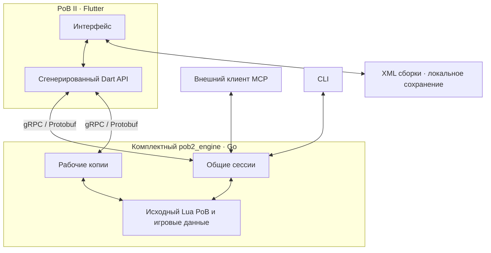
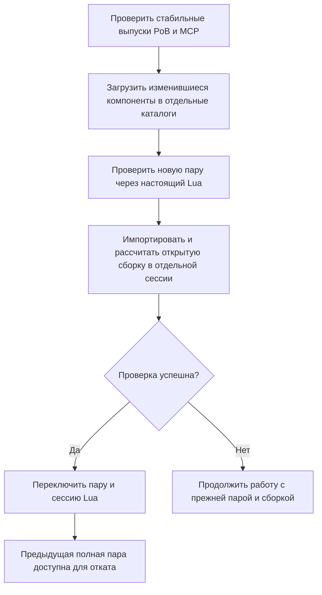

# pob2_ui

Отдельное Flutter-приложение с собственным интерфейсом для Path of Building — Path of Exile 2. Оно проверяет выпуски, загружает данные PoB и запускает оригинальные Lua-расчёты.

Приложение использует собственный дизайн. В 1.x комплектный [pob2_engine](https://github.com/Hecatoncheir/pob2_engine) управляет сессиями, расчётными процессами Lua, MCP и импортом из окна оригинального PoB.

## Текущий выпуск

**[PoB II v1.0.10](https://github.com/Hecatoncheir/pob2_ui/releases/tag/v1.0.10)** (`1.0.10+59`) выпущен из ветки `1.x.x` с комплектным [pob2_engine v0.0.18](https://github.com/Hecatoncheir/pob2_engine/releases/tag/v0.0.18). Доступны установщики Windows x64 (`.exe`), Linux x64 (`.run`) и macOS arm64 (`.dmg`). Контрольные суммы опубликованы в `SHA256SUMS`. [Подключение к общей сессии](docs/ENGINE-SESSION.md).

### Линия 0.x

Ветка `main` содержит линию 0.x.

**[PoB II v0.12.0](https://github.com/Hecatoncheir/pob2_ui/releases/tag/v0.12.0)** (`0.12.0+48`), 20 ноября 2026 года. Установщики: Windows x64 (`.exe`), Linux x64 (`.run`), macOS arm64 (`.dmg`); контрольные суммы — в `SHA256SUMS`.

В v0.12.0 исправлены названия повреждённых предметов и терминология переводов. MCP управляет всеми разделами и диалогами Flutter: снимок элементов и PNG окна, нажатия, формы, мышь и клавиши. `close_dialog` закрывает и «Полный DPS». Исправлена гонка восстановления заметок. [История изменений](CHANGELOG.md).

Закреплённая пара — **PoB v0.23.1** (`7d6f530`) и **MCP v0.23.0** (`1b3f61d`); полные ревизии — в [components-lock.json](tool/components-lock.json). Проверки и физические ограничения перечислены в [журнале v0.12.0](docs/acceptance-v0120.md). Следующий этап — [v0.13.0: ячейки умений и подбор поддержек](#продолжение-разработки).

## Сайт и галерея

[Сайт и загрузки](https://hecatoncheir.github.io/pob2_ui/) · [Галерея работающего приложения](https://hecatoncheir.github.io/pob2_ui/gallery.html) · [Логотип и иконки](https://hecatoncheir.github.io/pob2_ui/brand.html).

В `docs/` подготовлены [одностраничный сайт](docs/index.html), [интерактивный HTML/CSS/JS-прототип](docs/prototype.html) и [логотип, палитра и SVG-иконки](docs/brand.html). Направление «Искра»: молочный фон, графитовая графика, Nunito / Nunito Sans / JetBrains Mono и спокойные анимации. Шрифты включены локально.

Откройте HTML непосредственно или выполните `python -m http.server 4173 --bind 127.0.0.1 --directory docs` и перейдите на `http://127.0.0.1:4173/`. Прототип сохраняет идеи в браузере, но не подключается к Lua и использует демонстрационные данные. Новый дизайн перенесён во Flutter; рабочие данные приходят из Lua.

В мастерской — пять рабочих разделов, большой редактор и настраиваемая панель показателей с раскрываемыми подробностями. На узких экранах показатели открываются отдельно. Добавлены поиск по дереву, два варианта, отмена/повтор, сравнение и подготовка XML для Lua. Проверки данных прототипа: `node --test tool/design_state_test.cjs`.

[Описание дизайна и правила переноса](docs/DESIGN.md). Главная ведёт в галерею настоящих окон Flutter, включая примерку и поиск на рынке из v0.1.6. Ссылки `.exe` / `.dmg` / `.run` и номер стабильного выпуска подготавливает `node tool/update_site_release.cjs` из GitHub Releases. Workflow GitHub Pages проверяет сайт и обновляет его при изменениях `main` и после успешной публикации выпуска, включая выпуск через `GITHUB_TOKEN`. Ссылки работают и без JavaScript. Старый [HTML-прототип](docs/prototype.html) сохранён как материал разработки.

## Взаимодействие компонентов в линии 0.x



Flutter обращается к комплектному `pob2_engine` через сгенерированный Dart API.
Go передаёт сборку оригинальному Lua PoB и возвращает показатели и предупреждения.
Сеть нужна для первой загрузки данных PoB, поиска обновлений и импорта кодов сборок.
После установки данных расчёты доступны офлайн. XML обрабатывает локальный движок.

В настройках доступны десять языков с сохранением выбора. Переводы игровых строк загружаются отдельно и кешируются для работы без сети; неизвестные описания остаются в оригинале. Поиск понимает оригинальные и переведённые названия узлов. [Источники, ограничения и проверка локализации](docs/localization.md).

Кнопки отмены и повтора (Ctrl+Z / Ctrl+Shift+Z) восстанавливают изменения текущей сборки через Lua; история до 50 действий хранится в текущем сеансе. Новое изменение очищает историю повтора. При вводе текста действует обычная отмена ввода. Сочетания для отмены, повтора, новой сборки, XML и масштаба можно изменить в настройках. На широком экране боковая панель сворачивается кнопкой и меняет ширину перетаскиванием границы; настройки сохраняются после перезапуска.

В дереве нажмите «Сравнить пути» и выберите две цели. Для общих очков и оружия I/II исходный Lua отдельно рассчитывает оба варианта из текущего XML. Панель показывает режим очков, активное оружие, стоимость назначения, DPS и здоровье. Применение добавляет одно действие Undo/Redo и сохраняет заметки и план прокачки. После смены оружия, режима или сборки выполните расчёт заново. [Контракт и эталонные показатели](docs/LUA-CONTRACT.md#сравнение-путей-для-наборов-оружия-iii) · [Приёмка v0.9.0](docs/acceptance-v090.md).

## Обновление



В разделе «Компоненты» нажмите «Проверить обновления», затем «Обновить PoB и MCP». Приложение проверяет выбранные версии вместе. Если сборка открыта, отдельная сессия Lua импортирует её XML и пересчитывает показатели. До успешной проверки рабочая сессия остаётся открытой. При отказе доступны прежний отчёт и история действий. После успешного переключения или отката открытая сборка получает новый отчёт, а история действий начинается заново. XML в библиотеке сохраняется в прежнем виде до следующей правки.

Копии версий не перезаписываются. Для изменения активной пары используется файловая блокировка между экземплярами приложения и замена файла настроек после проверки. Откат доступен после появления предыдущей полной пары.

## Очистка профиля

В разделе «Компоненты» нажмите «Проверить место в профиле». Приложение покажет список и размеры данных. Отметьте нужные позиции и подтвердите очистку. В список могут попасть кеш дерева, скачанные архивы, старые версии компонентов с меткой PoB II и внутренние ревизии XML, которые не нужны текущему и резервному индексам. Метка появляется при установке компонентов в v0.7.0 и новее.

PoB II сохраняет рабочую пару и пару для отката, общие папки сборок, заметки и резервные копии. Если другой экземпляр использует тот же профиль, закройте его перед подтверждением очистки. После удаления кеша дерева приложение восстановит его при загрузке дерева из Lua.

## Что работает

- Молочный интерфейс «Искра»: локальные шрифты, векторная надпись PoB II, иконки, плавные переходы и системное уменьшение движения. Библиотека, мастерская и компоненты; пять рабочих разделов и панель показателей.
- Ручная проверка последних стабильных GitHub Releases двух проектов.
- Комплектный движок загружает и проверяет официальные данные PoB. Установленному приложению нужны только Flutter-комплект и движок из поставки.
- Отображение установленного тега, доступного выпуска, точной Git-ревизии и каталога.
- Проверка совместимости через `doctor`; откат к предыдущей полной паре.
- Подключение MCP в режиме `engine` через stdin/stdout, получение списка классов из Lua.
- Создание пустой сборки с выбранными классом и уровнем.
- Импорт полного XML, расчёт, показатели, условия, предупреждения и полный отчёт Lua.
- Открытие и сохранение XML через системные диалоги, общая папка сборок, заметки, резервные копии, автоматическое сохранение последнего успешного состояния и его восстановление.
- Обмен кодами PoB, импорт по ссылкам `pobb.in` и экспортам `poe.ninja`, повторное открытие сохранённых сборок без сети.
- В дереве кнопка «Сравнить пути» позволяет выбрать два целевых узла и сравнить стоимость в общих очках или очках оружия I/II, DPS и здоровье при одинаковых условиях. Выбранный путь применяется одним действием с Undo/Redo.
- Управление приложением через MCP: библиотека, файлы, заметки, этапы прокачки, настройки, обновление компонентов и завершение. Доступ включается пользователем; [инструкция подключения](docs/MCP-EDITOR.md).

Подключено готовое оригинальное дерево `PassiveTreeView`: фоны, портреты, дуги, рамки и иконки. Flutter показывает сцену Lua, позволяет искать и выбирать узлы; назначение пути и возврат определяет PoB. Работают создание, изменение и удаление групп умений, полный каталог условий, библиотека XML с поиском, переименованием, заметками и копированием. Умения показаны списком слева, все добавленные камни видны; справа — каталог совместимых поддержек с оригинальными картинками. Перенос в группу добавляет поддержку, обратно в каталог — убирает. Основное умение выбирается галочкой у названия; нажатие названия открывает редактор существующей группы. Активный камень всегда первый, поддержки рядом. Удаление корзиной можно отменить через Undo/Ctrl+Z и повторить через Redo. Предпросмотр поддержки показывает DPS до, после и разницу, рассчитанные Lua для всей группы. Доступное число ячеек конкретного умения и ранжирование поддержек запланированы в v0.13.0. [Контракт Lua и воспроизведение проверок](docs/LUA-CONTRACT.md).

Редактор экипировки поддерживает схему слотов, ввод игрового текста, выбор сохранённого предмета, установку/замену/снятие, наборы I/II и Undo/Redo. Описание, требования, совместимость и влияние на показатели получает исходный Lua. Подсказки камней умений и поддержки используют оригинальный `GemTooltip`; установленный камень описывается с его текущим контекстом, черновик — с введёнными уровнем и качеством. Игровые изображения доступны для экипировки и самоцветов; пустые слоты обозначены схематическими иконками.

Примерка «Было → Стало» показывает изменение характеристик из Lua до применения предмета. Кнопка «Искать на рынке» открывает форму с лигой, базой, бюджетом и свойствами; подготовленная ссылка открывается в браузере. Скопированный предмет можно вернуть в редактор для примерки и применения с Undo/Redo. Поддержки умений от экипировки редактируются отдельно; само умение и его уровень задаёт предмет.

## Установка и обновление приложения

Подготовлены установщики Windows x64 (`.exe`), Linux x64 (`.run`) и macOS Apple Silicon (`.dmg`), CI и публикация по стабильному тегу. Встроенная проверка обновлений доступна через номер версии в нижнем блоке бокового меню. Загрузка возобновляется и проверяет SHA-256; установка запускается по кнопке «Перезапустить и обновить» после сохранения сборки и XML. Предыдущая версия сохраняется для восстановления при неудачном старте. Для portable-копии предлагается страница выпусков.

[Устройство установщиков, выпуск, ограничения подписи и проверки](installer/README.md) · [Changelog](CHANGELOG.md) · [Выпуски](https://github.com/Hecatoncheir/pob2_ui/releases).

Установщик включает pob2_engine. Движок устанавливает данные оригинального PoB и подготавливает LuaJIT. Первый запуск с пустым кэшем требует сети.

В «Оформлении» можно выбрать светлую тему или тёмную [Gruvbox](https://github.com/morhetz/gruvbox); выбор сохраняется после перезапуска. Кнопка с графиком рядом с поиском дерева открывает поиск по характеристике и расстоянию: Lua рассчитывает влияние и тепловую карту, нажатие строки списка перемещает дерево к узлу.

Во вкладке «Дерево» переключите правую панель с «Параметров» на «План». Выберите нужные узлы и сохраните этап с уровнем персонажа. Кнопка с карандашом меняет уровень выбранного этапа. Несколько этапов могут относиться к одному уровню. При выборе этапа дерево показывает его сохранённые узлы, зелёным отмечает добавленные, а красным — снятые с предыдущего этапа. Наведение на название подсвечивает узел, а нажатие приближает его.

У этапа можно указать название, например «Акт 2», и заметку. Карандаш открывает редактирование этих полей и уровня. Название видно на шкале, заметка — при выборе этапа. «Экспорт XML» и «Скопировать XML» включают этапы вместе с названиями и заметками. Чтобы получить сборку вместе с планом, откройте этот файл или вставьте XML в PoB II.

При сохранении нового этапа PoB II запоминает активные наборы умений и экипировки. Кнопка «Применить этап» позволяет выбрать уровень и дерево, умения, экипировку или любую их комбинацию. Lua пересчитывает сборку после применения, а всё изменение можно отменить одним действием. В ранее сохранённых этапах доступны те данные, которые были в них записаны. Новые наборы переносятся вместе с планом через XML.

Перед подтверждением PoB II показывает, какие узлы добавятся или снимутся относительно текущего дерева, и сравнивает показатели «Было → Стало». Предпросмотр учитывает выбранные части этапа и рассчитывается в отдельной сессии Lua.

В предпросмотре можно раскрыть изменения умений и экипировки, открыть описание камня или предмета и прочитать предупреждения PoB. Чтобы сравнить два сохранённых этапа, выберите целевой этап и нажмите «Сравнить с другим этапом».

Кнопка «Обновить этап из сборки» позволяет заменить выбранные части сохранённого этапа. Задачи можно добавить в редакторе этапа. В режиме прохождения виден следующий незавершённый этап, а задачи и сам этап можно отмечать по мере выполнения. Отметки сохраняются в плане и переносятся через XML.

В режиме прохождения нажмите «Что осталось до следующего этапа?», чтобы сверить уровень, узлы, умения и экипировку с планом и увидеть незавершённые задачи. Кнопка с нумерованным списком у выбранного этапа задаёт порядок ключевых узлов. Команда «Путь к следующему узлу» подсвечивает маршрут, рассчитанный Lua PoB, а порядок узлов переносится через XML.

На шкале показаны до двух самых заметных изменений показателей относительно предыдущего этапа. «Список покупок» показывает недостающие камни, предметы и самоцветы по этапам. Из строки экипировки можно открыть поиск на рынке с подставленной базой предмета.

## Запуск на Windows

Требуются Windows x64, Flutter 3.50.0 (Dart 3.14.0), Visual Studio с инструментами C++, Git и Python x64 3.11+. Эти инструменты нужны для разработки и сборки. Установленное приложение запускает комплектный pob2_engine.

```powershell
flutter pub get --offline
flutter run -d windows --no-pub
```

`--offline` использует уже имеющийся кеш Flutter. Если нужных зависимостей нет в кеше, выполните `flutter pub get`. Интерфейс использует `material_ui` для виджетов, `flutter_bloc` для управления состоянием и `file_selector` для системных файловых диалогов. Репозитории PoB и MCP загружаются самим приложением после нажатия «Скачать», без `pip install`.

При первом запуске откроется мастер подготовки. Нажмите «Установить компоненты»: PoB II загрузит недостающие компоненты, проверит их совместимость и подключит Lua. Для загрузки компонентов нужен интернет. Затем мастер предложит подключить папку сборок, создать сборку, открыть XML или импортировать данные из PoB. Продолжить подготовку можно в любой момент: «Настройки → Запустить подготовку».

Кнопки открытия и экспорта в заголовке сборки вызывают системные диалоги. Доступны Ctrl+O и Ctrl+S (на macOS также Cmd). Через меню «Ещё» можно вставить или скопировать XML и открыть заметки. Заметки также доступны на карточках в «Мои сборки». Последняя успешная сборка восстанавливается автоматически.

### Общая папка сборок Path of Building

На Linux и macOS без доступного Wine PoB II при первом запуске создаёт и подключает `~/Documents/PoE2/` для сохранения XML. Если папка уже настроена, приложение использует её. Путь можно сменить в разделе «Мои сборки» → «Папка сборок».

«Найти папку PoB» сначала запрашивает путь через локальный мост на Windows и Linux с Wine. Если окно PoB закрыто, PoB II запускает его свёрнутым. Если получить путь не удалось, PoB II ищет существующую стандартную папку PoB. Этот поиск также доступен на macOS. Если подходящих папок несколько или ни одной нет, укажите нужную вручную. После подключения путь, смена папки и обновление списка доступны в «Моих сборках» через кнопку «Папка сборок». Окно PoB для работы с файлами не требуется.

PoB II открывает XML из этого каталога и его подпапок. Изменения сохраняются в тот же XML после расчёта. Новые сборки, копии и импортированные персонажи получают отдельные файлы. Кнопка обновления перечитывает список. Открытая сборка обновляется автоматически после сохранения XML в Path of Building. PoB II получает уведомление файловой системы и обновляет расчёт через Lua после завершения текущей операции или закрытия диалога. При возвращении фокуса в окно или обновлении списка сборок PoB II один раз сверяет открытый файл с диском.

Чтобы открыть текстовый код Path of Building 2, скопируйте его в буфер обмена и выберите «Вставить код PoB». Если сборка уже открыта, команда находится в меню «Ещё». PoB II создаст отдельную запись в библиотеке и рассчитает её на оригинальном Lua.

Чтобы открыть сборку, выберите «Импортировать по ссылке», вставьте `https://pobb.in/…` или `https://poe.ninja/poe2/pob/…` и нажмите «Открыть и рассчитать». Поддерживаются также raw-ссылки poe.ninja и прежний домен `poe2.ninja`. Для загрузки кода нужен интернет. Импортированная сборка появится отдельной записью в библиотеке, откуда её можно открыть без сети.

Для ссылки на профиль или страницу персонажа poe.ninja диалог показывает отдельный путь: «Открыть poe.ninja» → на сайте «Copy PoB code» → в PoB II «Вставить код PoB». Внутренний API профилей не вызывается; готовый код предоставляет сам сайт. Пока код не импортирован, текущая сборка и история сохраняются. Отмена диалога ничего не импортирует.

Чтобы передать сборку обратно в PoB, откройте меню «Ещё» и выберите «Скопировать код PoB». Затем вставьте код во вкладку импорта и экспорта оригинального PoB. Обмен текстовыми кодами работает офлайн после установки компонентов.

При первом подключении каталога прежние сборки и заметки PoB II копируются в него. Исходные файлы в профиле остаются на месте. Если в общей папке уже есть одноимённая сборка, миграция сохраняет новую копию под другим именем. Заметки хранятся внутри XML и доступны в обеих программах.

Перед заменой XML PoB II сохраняет предыдущую версию в `.bak`. При переименовании и удалении прежний XML остаётся в отдельном файле `.bak`. PoB II хранит последнюю версию своих правок в профиле. Если сохранение из Path of Building заменит её, в «Моих сборках» появится отдельная сборка с суффиксом «правки PoB II», а в редакторе загрузится XML из Path of Building. Выбор версии остаётся за пользователем. После загрузки внешних изменений история Undo/Redo начинается заново.

Путь к общей папке и последняя открытая сборка записываются в `pob-builds.json` в профиле PoB II. Там же остаются настройки, черновики XML и загруженные компоненты. Для отдельного профиля задайте `POB2_UI_HOME`, для выбора интерпретатора — абсолютный путь в `POB2_UI_PYTHON`.

### Импорт из открытого Path of Building

На Windows команды поиска папки сборок, импорта из окна PoB и импорта персонажей сначала используют уже работающий мост. При необходимости PoB II подключает мост и запускает Path of Building свёрнутым. Если отдельная установка PoB отсутствует, используется загруженный компонент Path of Building. Для нескольких установок или переносной версии в другом каталоге выберите нужную папку в «Компоненты» → «Настроить мост PoB». Если PoB уже открыт без работающего моста, перезапустите его один раз. Для импорта текущей сборки разверните PoB с панели задач и откройте в нём сборку.

С MCP v0.18.1 и новее войдите в аккаунт в оригинальном PoB, оставьте его запущенным и нажмите «Импортировать персонажа» в «Моих сборках» или в меню «Ещё» открытой сборки. PoB II получит список через локальный мост и сохранит выбранного персонажа отдельной сборкой с экипировкой, умениями, деревом и самоцветами. После обновления MCP подключите мост заново и перезапустите оригинальный PoB.

На Linux команды моста могут запускать установленный Windows-выпуск PoB через Wine в сеансе X11 или XWayland. Если PoB установлен в другом префиксе, запустите PoB II с тем же `WINEPREFIX` или укажите папку установки в «Компоненты» → «Настроить мост PoB». PoB II запускает окно свёрнутым и при выходе запрашивает штатное закрытие. Для других графических сеансов можно открыть PoB через Wine вручную и использовать подключённый мост.

Оставьте сборку открытой в оригинальном PoB и нажмите «Импортировать из PoB» на экране «Мои сборки» или в мастерской PoB II. Если в мастерской уже открыта другая сборка, команда находится в меню «Ещё». Мост передаст снимок текущей сборки, а PoB II сохранит его отдельной записью в «Моих сборках».

При выходе PoB II запрашивает обычное закрытие окон PoB, которые сам запустил в этом сеансе. Если PoB покажет запрос на сохранение, ответьте в его окне. Самостоятельно открытые экземпляры PoB продолжают работать.

### Создание и правки сборок через MCP

В мастерской или в разделе «Мои сборки» нажмите «Правки через MCP» и включите «Разрешить правки через MCP». Доступ можно включить до подключения Lua, если установлен MCP. Скопируйте команду подключения Codex и выполните её в терминале. Состояние приложения доступно при открытом диалоге; `pob_editor_app` с `action: close_dialog` закрывает верхнее окно, включая «Полный DPS». Для явной отмены формы добавьте `discard: true`, для сохранения нажмите её обычную кнопку через MCP.

Для работы из локального терминала можно явно запустить PoB II с `--mcp-editor`. Флаг разрешает доступ только на время этого запуска и не сохраняется в настройках. Команда перезапуска через MCP не переносит этот флаг.

Для создания нужен MCP 0.19.0 или новее. Обновите PoB MCP в разделе «Компоненты». Вызовите `pob_catalog` с `{"kind":"classes"}`, чтобы узнать ID класса. Передайте выбранный `classId`, `name` и `level` в `pob_create_build`. PoB II сохранит отдельный XML в библиотеке, откроет сборку и вернёт её ID и отчёт Lua. Тот же клиент может продолжить редактирование сразу после создания.

Команды для дерева, предметов и умений меняют открытую сборку. PoB II показывает изменённую вкладку, пересчитывает показатели в Lua и добавляет правку в общую историю Undo/Redo. После ручной правки клиенту MCP нужно заново прочитать отчёт сборки. Доступ выключен при запуске и сбрасывается при ручной смене сборки. Авторизованные команды MCP могут переключать сборки, переподключать Lua и менять компоненты с сохранением канала.

Расширенные команды управляют библиотекой, файлами, заметками, Undo/Redo, планом прокачки, компонентами, настройками и завершением приложения. Начните с `pob_editor_status`; обновление и откат компонентов выполняются фоном с результатом через `pob_editor_job`. С PoB II 0.12.0 и MCP 0.23.0 `pob_editor_ui` также предоставляет `snapshot`, `perform`, `screenshot`, `gesture` и `key` для работы с обычным интерфейсом. Системные окна выбора файла заменяются файловой командой с явным путём. После обновления MCP переподключите клиент, чтобы перечитать список инструментов. [Протокол и проверки](docs/MCP-EDITOR.md).

## Структура исходников

```text
lib/
  domain/               модели компонентов и версий
  data/                 GitHub, Git, процессы, MCP, настройки и XML
  ui/                   представления и Cubit
test/                   проверки сохранения, ошибок обновления и интерфейса
tool/smoke.dart          проверка с настоящими Lua и MCP
windows/                стандартный Windows runner Flutter
```

## Проверки

```powershell
dart format --output=none --set-exit-if-changed lib test tool integration_test test_driver
flutter analyze --no-pub
flutter test --no-pub
flutter build windows --release --no-pub
dart run tool/smoke.dart --install
```

Последняя команда проверяет актуальные выпуски, загружает отсутствующие версии, запускает `doctor`, читает каталог, создаёт сборку, проверяет реальные показатели и повторный импорт экспортированного XML. Без `--install` использует уже загруженные компоненты. Проверка PoB не означает испытание сборки в игре.

Для воспроизводимой проверки закреплённой пары используйте отдельный `POB2_UI_HOME` и `dart run tool/smoke.dart --install --lock tool/components-lock.json`. В v0.12.0 закреплены PoB v0.23.1 и MCP v0.23.0. Проверяются импорт, XML, дерево и правки через внешний MCP-клиент; успешный расчёт PoB не означает испытание сборки в игре.

CI проверяет установщики и настоящий Lua отдельно от физической приёмки интерфейса. Для v0.12.0 пользователь подтвердил доступность Windows и CI; Wayland, Gatekeeper и раскладки macOS физически не проверены. Интерактивная проверка нативного XML-диалога Windows остановлена Esc и не считается завершённой. Эти ограничения сохранены в [журнале приёмки](docs/acceptance-v0120.md).

## Читаемость и архитектура

`WorkshopCubit` и `AppUpdateCubit` публикуют неизменяемые состояния; представления используют `BlocBuilder` / `BlocSelector`. Records связывают небольшие группы данных, например операцию и черновик XML, а patterns проверяют обязательные поля ответа Lua. Игровых формул в Dart нет.

`python tool/check_complexity.py` использует закреплённые ревизии [treesitter_cyclomatic_complexity](https://github.com/Hecatoncheir/treesitter_cyclomatic_complexity) и грамматики Dart. Проверяется `lib/` и запускатель; вложенные замыкания учитываются в родительской функции. Предел когнитивной сложности — 10. Нужны Neovim 0.11+, Git и CMake с компилятором C; грамматика собирается только в `build/`. Отчёт — `build/complexity/report.json`. Эта метрика дополняет чтение кода, анализ и тесты.

В GitHub Actions сложность сравнивается с базой pull request или предыдущей ревизией ветки. Сводка показывает COG до и после, а предупреждения указывают на функции, которые стали сложнее. Превышение 10 останавливает проверку. Полный отчёт и список изменений доступны в артефакте `complexity-report`. Для такого же сравнения локально используйте `python tool/check_complexity.py --base origin/main`.

## Продолжение разработки

План актуализирован 20 ноября 2026 года для v0.12.0. Подробные задачи, зависимости и критерии готовности ведутся в [TODO.md](TODO.md#приоритеты-и-следующие-выпуски).

| Целевой выпуск | Приоритет | Состав | Условие начала |
| --- | --- | --- | --- |
| [**v0.13.0**](TODO.md#v0130--ячейки-умений-и-подбор-поддержек) | **P1** | Ячейки конкретного умения, рекомендации и сравнение поддержек по расчёту Lua ([#19](https://github.com/Hecatoncheir/pob2_ui/issues/19)) | Сначала подтвердить контракт Lua/MCP |
| [**v0.14.0**](TODO.md#v0140--подпись-установщиков) | **P2** | Подпись Windows, Developer ID и нотариализация macOS ([#21](https://github.com/Hecatoncheir/pob2_ui/issues/21)) | Доступны сертификаты и учётные данные издателя |
| [**v0.15.0**](TODO.md#v0150--группа-и-эффекты-союзников) | **P2** | Группа и эффекты союзников через исходный Lua | Подтверждён публичный контракт PoB/MCP |
| [**v0.16.0**](TODO.md#v0160--импорт-аккаунта-и-торговые-объявления) | **P3** | Прямой импорт аккаунта и встроенная выдача торговых объявлений | Подтверждён доступ GGG к нужным API |

P1 — ближайшая работа, P2 — последующие задачи и внешние условия, P3 — дальний этап. Подтверждённая потеря данных, неверный расчёт или невозможность запуска получают P0 и исправляются вне очереди в ближайшем `0.12.x` либо текущем кандидате.

v0.12.0 закрывает имена предметов, проверку основных переводов и диапазонов, описание запускателя и полное управление интерфейсом MCP. Искажённые исходным PoB имена заменяются сохранившейся базой, без изменения XML и расчёта. Открытые физические проверки ОС перечислены отдельно; они не подменяются результатами CI.

Даты следующих выпусков пока не назначены. При недоступной внешней зависимости следующий доступный этап можно поднять в очереди, обновив номера в обоих документах; подпись пакетов можно выпустить раньше отдельным исправлением. Номер текущей версии при планировании не меняется. Выпуск требует проверок кандидата, обновления с последней стабильной версии, трёх установщиков и согласованных TODO/README. [Общие условия](TODO.md#условия-следующих-выпусков).

Не расширяйте существующий Flutter-проект внутри форка PoB: вся дальнейшая работа ведётся в этом репозитории. Исходные компоненты остаются отдельными зависимостями.

## Источники

- [Официальный PathOfBuilding-PoE2](https://github.com/PathOfBuildingCommunity/PathOfBuilding-PoE2).
- [MCP-адаптер и его API](https://github.com/Hecatoncheir/pob-poe2-mcp).
- [Документация Flutter](https://docs.flutter.dev/).

Лицензии и уведомления исходных компонентов сохраняются в загруженных репозиториях. Игровые ресурсы остаются собственностью их правообладателей.

Окно запоминает размер, положение и развёрнутое состояние. На Windows это проверено настоящими перезапусками, включая отключённый экран. Дерево не содержит постоянных подписей: сведения и изменения показателей появляются при наведении, а клик назначает/возвращает узел через Lua.
