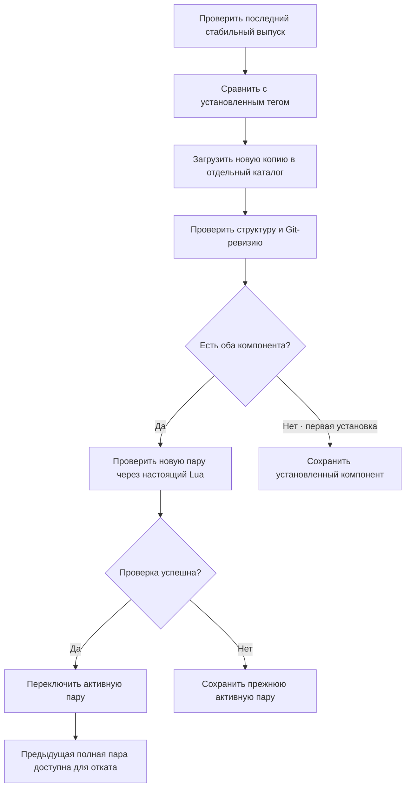

# pob2_ui

Отдельное Flutter-приложение с собственным интерфейсом для Path of Building — Path of Exile 2. Оно загружает PoB и MCP, проверяет выпуски и запускает оригинальные Lua-расчёты.

Проект начинается с нового дизайна. Интерфейс из `Hecatoncheir/PathOfBuilding-PoE2/app` не переносится. Сохраняется архитектурный принцип связи с отдельным процессом Lua; транспорт реализован через API самостоятельного [pob-poe2-mcp](https://github.com/Hecatoncheir/pob-poe2-mcp).

## Дизайн-прототип

[Сайт](https://hecatoncheir.github.io/pob2_ui/) · [Прототип приложения](https://hecatoncheir.github.io/pob2_ui/prototype.html) · [Логотип и иконки](https://hecatoncheir.github.io/pob2_ui/brand.html).

В `docs/` подготовлены [одностраничный сайт](docs/index.html), [интерактивный HTML/CSS/JS-прототип](docs/prototype.html) и [логотип, палитра и SVG-иконки](docs/brand.html). Направление «Искра»: молочный фон, графитовая графика, Nunito / Nunito Sans / JetBrains Mono и спокойные анимации. Шрифты включены локально.

Откройте HTML непосредственно или выполните `python -m http.server 4173 --bind 127.0.0.1 --directory docs` и перейдите на `http://127.0.0.1:4173/`. Прототип сохраняет идеи в браузере, но не подключается к Lua и использует демонстрационные данные. Новый дизайн перенесён во Flutter; рабочие данные приходят из Lua.

В мастерской — пять рабочих разделов, большой редактор и настраиваемая панель показателей с раскрываемыми подробностями. На узких экранах показатели открываются отдельно. Добавлены поиск по дереву, два варианта, отмена/повтор, сравнение и подготовка XML для Lua. Проверки данных прототипа: `node --test tool/design_state_test.cjs`.

[Описание дизайна и правила переноса](docs/DESIGN.md). Workflow GitHub Pages проверяет JavaScript и данные прототипа, затем публикует каталог `docs` при изменениях в `main`.

## Взаимодействие компонентов


Обычный запрос: **действие пользователя → Cubit → MCP stdio → Python-адаптер → исходные классы Lua → результат → Flutter**. Flutter отображает показатели и предупреждения; игровые формулы и правила остаются в PoB. Для расчёта не требуется открывать оригинальное окно PoB или подключаться к облачному сервису.

Сеть нужна для загрузки компонентов и проверки обновлений. После установки расчёты работают локально. Сборка из пользовательского XML отправляется только локальному процессу MCP; запросам GitHub XML не передаётся.

В настройках доступны десять языков с сохранением выбора. Переводы игровых строк загружаются отдельно и кешируются для работы без сети; неизвестные описания остаются в оригинале. Поиск понимает оригинальные и переведённые названия узлов. [Источники, ограничения и проверка локализации](docs/localization.md).

Кнопки отмены и повтора (Ctrl+Z / Ctrl+Shift+Z) восстанавливают изменения текущей сборки через Lua; история до 50 действий хранится в текущем сеансе. Новое изменение очищает историю повтора. При вводе текста действует обычная отмена ввода. Сочетания для отмены, повтора, новой сборки, XML и масштаба можно изменить в настройках. На широком экране боковая панель сворачивается кнопкой и меняет ширину перетаскиванием границы; настройки сохраняются после перезапуска.

## Обновление



PoB и MCP версионируются отдельно. Проверка `doctor` подтверждает загрузку движка и чтение каталога классов; она не доказывает совместимость всех сборок и механик с будущей версией. Для проверки конкретной сборки необходим импорт её XML и анализ отчёта. Обновление и откат закрывают текущую сессию движка; последнюю успешно рассчитанную сборку можно восстановить из XML.

Копии версий не перезаписываются. Для изменения активной пары используется файловая блокировка между экземплярами приложения и замена файла настроек после проверки. Неудачные загрузки пока сохраняются в каталоге версий; автоматическая очистка ещё не реализована. Откат доступен после появления предыдущей полной пары.

## Что работает

- Молочный интерфейс «Искра»: локальные шрифты, векторная надпись PoB II, иконки, плавные переходы и системное уменьшение движения. Библиотека, мастерская и компоненты; пять рабочих разделов и панель показателей.
- Ручная проверка последних стабильных GitHub Releases двух проектов.
- Загрузка исходников по тегу в отдельные Git-копии. Для PoB загружаются `src/`, `runtime/` и корневые файлы.
- Отображение установленного тега, доступного выпуска, точной Git-ревизии и каталога.
- Проверка совместимости через `doctor`; откат к предыдущей полной паре.
- Подключение MCP в режиме `engine` через stdin/stdout, получение списка классов из Lua.
- Создание пустой сборки с выбранными классом и уровнем.
- Импорт полного XML, расчёт, показатели, условия, предупреждения и полный отчёт Lua.
- Экспорт XML в поле интерфейса; автоматическое сохранение последнего успешного состояния и его восстановление.

Подключено готовое оригинальное дерево `PassiveTreeView`: фоны, портреты, дуги, рамки и иконки. Flutter показывает сцену Lua, позволяет искать и выбирать узлы; назначение пути и возврат определяет PoB. Работают создание, изменение и удаление групп умений, полный каталог условий, библиотека XML с поиском, переименованием, заметками и копированием. Умения показаны списком слева, все добавленные камни видны; справа — каталог совместимых поддержек с оригинальными картинками. Перенос в группу добавляет поддержку, обратно в каталог — убирает. Основное умение выбирается галочкой у названия; нажатие названия открывает редактор существующей группы. Активный камень всегда первый, поддержки рядом. Удаление корзиной можно отменить через Undo/Ctrl+Z и повторить через Redo. Для всех этих операций нужен [MCP v0.12.0](https://github.com/Hecatoncheir/pob-poe2-mcp/releases/tag/v0.12.0) или новее. Группы с несколькими активными камнями и группы от предметов пока не редактируются этой формой. Эффекты мастерства, share-коды и встроенные Git/Python остаются отдельными задачами. [Контракт Lua и воспроизведение проверок](docs/LUA-CONTRACT.md).

В текущей ветке после v0.1.3 добавлен редактор экипировки: знакомая схема слотов, ввод игрового текста, выбор сохранённого предмета, установка/замена/снятие, наборы I/II и Undo/Redo. Описание, требования, совместимость и влияние на показатели получает исходный Lua. Подсказки камней умений и поддержки используют оригинальный `GemTooltip` через [MCP v0.14.0](https://github.com/Hecatoncheir/pob-poe2-mcp/releases/tag/v0.14.0); установленный камень описывается с его текущим контекстом, черновик — с введёнными уровнем и качеством. Иконки слотов пока схематические. Эти изменения ещё не входят в опубликованный интерфейс v0.1.3.

## Установка и обновление приложения

Стабильный выпуск — [PoB II v0.1.3](https://github.com/Hecatoncheir/pob2_ui/releases/tag/v0.1.3), проверенный с [MCP v0.12.0](https://github.com/Hecatoncheir/pob-poe2-mcp/releases/tag/v0.12.0). Доступны Windows x64, Linux x64 и macOS arm64. Релизный CI прошёл на всех трёх ОС; SHA-256 скачанных установщиков подтверждён.

Подготовлены установщики Windows x64 (`.exe`), Linux x64 (`.run`) и macOS Apple Silicon (`.dmg`), CI и публикация по стабильному тегу. Встроенная проверка обновлений доступна через номер версии в нижнем блоке бокового меню. Загрузка возобновляется и проверяет SHA-256; установка запускается по кнопке «Перезапустить и обновить» после сохранения сборки и XML. Предыдущая версия сохраняется для восстановления при неудачном старте. Для portable-копии предлагается страница выпусков.

[Устройство установщиков, выпуск, ограничения подписи и проверки](installer/README.md) · [Changelog](CHANGELOG.md) · [Выпуски](https://github.com/Hecatoncheir/pob2_ui/releases).

Git и 64-битный Python 3.11+ пока нужны на всех платформах. Нативные библиотеки MCP загружаются отдельно; игровые исходники не входят в этот Git-репозиторий. Linux/macOS используют настоящий Lua в режиме `engine`; изображения отчётов через GDI остаются особенностью Windows; ресурсы готового дерева и поиск влияния узлов доступны на всех трёх ОС через MCP 0.9.1.

В «Оформлении» можно выбрать светлую тему или тёмную [Gruvbox](https://github.com/morhetz/gruvbox); выбор сохраняется после перезапуска. Кнопка с графиком рядом с поиском дерева открывает поиск по характеристике и расстоянию: Lua рассчитывает влияние и тепловую карту, нажатие строки списка перемещает дерево к узлу.

## Запуск на Windows

Требуются Windows x64, Flutter с поддержкой Windows, Visual Studio с инструментами C++, Git и Python x64 3.11+. Для уже собранного приложения Flutter и Visual Studio не нужны; Git и Python пока нужны.

```powershell
flutter pub get --offline
flutter run -d windows --no-pub
```

`--offline` использует уже имеющийся кеш Flutter. Если нужных зависимостей SDK нет в кеше, обычный `flutter pub get` обращается к pub.dev. Прямые зависимости — Flutter SDK, Flutter Test SDK, `flutter_bloc` и официальный `file_selector` для системных файловых диалогов; сторонние MCP-серверы в систему не устанавливаются. Репозитории PoB и MCP загружаются самим приложением после нажатия «Скачать», без `pip install`.

В приложении нажмите «Проверить обновления», скачайте оба компонента, затем «Подключить Lua». Создайте сборку в мастерской, выбрав класс и уровень, или откройте полный XML. Кнопки открытия и экспорта в заголовке сборки вызывают системные диалоги; доступны Ctrl+O и Ctrl+S (на macOS также Cmd). Через меню «Ещё» можно вставить или скопировать XML и открыть заметки. Заметки также доступны на карточках в «Мои сборки». Последняя успешная сборка восстанавливается автоматически.

Настройки и данные:

```text
%LOCALAPPDATA%/pob2_ui/
  components.json       активная и предыдущая пары компонентов
  session.xml           последняя успешно рассчитанная сборка
  draft.xml             автоматически сохраняемый незавершённый XML
  notes/<id>.md         локальные заметки к сборке
  builds/index.json     библиотека и ссылка на активную ревизию XML
  builds/revisions/     неизменяемые сохранённые XML
  builds/<id>.xml       совместимая копия XML для прежних версий
  updates/              кеш проверяемых обновлений приложения
  versions/             отдельные Git-копии PoB и MCP
```

Заметки сохраняются автоматически и копируются вместе со сборкой. Они хранятся отдельно от игрового XML: экспорт файла переносит данные PoB, а заметки остаются в локальном профиле. Undo/Redo игровых изменений заметки не меняет.

Сохранение сначала записывает временный файл, затем заменяет основной; для индекса, сессии, заметок и черновика остаётся резервная копия `.bak`. Библиотека ссылается на неизменяемую ревизию XML, поэтому сбой новой записи индекса сохраняет прежнюю рабочую сборку. При ошибочном импорте восстанавливаются предыдущие XML и состояние Lua. Перед переключением и закрытием завершается запись текста; ошибка сохранения отменяет закрытие и показывает причину. Старые ревизии пока не удаляются автоматически.

Для другого каталога задайте `POB2_UI_HOME`. Для явного выбора интерпретатора задайте `POB2_UI_PYTHON` абсолютным путём к `python.exe`. В первой версии предполагается одна активная сессия редактирования: автосохранение сборки пока не рассчитано на одновременную работу нескольких окон.

## Структура исходников

```text
lib/
  domain/               модели компонентов и версий
  data/                 GitHub, Git, процессы, MCP, настройки и XML
  ui/                   представления и Cubit
test/                   проверки сохранения, ошибок обновления и интерфейса
tool/smoke.dart          проверка с настоящими Lua и MCP
windows/                стандартный Windows runner Flutter
```

## Проверки

```powershell
dart format --output=none --set-exit-if-changed lib test tool
flutter analyze --no-pub
flutter test --no-pub
flutter build windows --release --no-pub
dart run tool/smoke.dart --install
```

Последняя команда проверяет актуальные выпуски, загружает отсутствующие версии, запускает `doctor`, читает каталог, создаёт сборку, проверяет реальные показатели и повторный импорт экспортированного XML. Без `--install` использует уже загруженные компоненты. Проверка PoB не означает испытание сборки в игре.

5 ноября 2026 года проверен полный путь на загруженных с GitHub **PoB v0.23.1** (`7d6f530cbdab20389ff8bc6ba97a37ac27f74e41`) и **MCP v0.4.0** (`a0566a1199e61144f281b1703f84f4d139e83682`): 8 классов, создание Witch уровня 90, `source: original-lua`, Life 1187, экспорт и повторный импорт с тем же Life. Это техническая проверка пустой сборки, а не рекомендуемый игровой билд.

Статический анализ, проверки состояния, загрузки, контрольных сумм, безопасной распаковки и навигации проходят. CI отдельно проверяет три установщика и настоящий Lua. Полная ручная приёмка пользовательских сценариев и нового дизайна ещё не выполнена.

## Читаемость и архитектура

`WorkshopCubit` и `AppUpdateCubit` публикуют неизменяемые состояния; представления используют `BlocBuilder` / `BlocSelector`. Records связывают небольшие группы данных, например операцию и черновик XML, а patterns проверяют обязательные поля ответа Lua. Игровых формул в Dart нет.

`python tool/check_complexity.py` использует закреплённые ревизии [treesitter_cyclomatic_complexity](https://github.com/Hecatoncheir/treesitter_cyclomatic_complexity) и грамматики Dart. Проверяется `lib/` и запускатель; вложенные замыкания учитываются в родительской функции. Предел когнитивной сложности — 10. Нужны Neovim 0.11+, Git и CMake с компилятором C; грамматика собирается только в `build/`. Отчёт — `build/complexity/report.json`. Эта метрика дополняет чтение кода, анализ и тесты.

Официальный [Dart and Flutter](https://github.com/flutter/agent-plugins) версии 1.0.7 уже установлен в рабочем окружении: используются его навыки архитектуры, patterns, анализа и MCP. Сторонние исходники инструментов не входят в Git приложения.


## Продолжение разработки

Этапы, зависимости и критерии готовности ведутся в [TODO.md](TODO.md).

| Следующий выпуск | Состав | Целевая дата |
| --- | --- | --- |
| [v0.2.0](https://github.com/Hecatoncheir/pob2_ui/milestone/1) | Новый Flutter-интерфейс, отчёты Lua, библиотека и XML, компоненты, установщики трёх ОС | 19 ноября 2026 |
| [v0.3.0](https://github.com/Hecatoncheir/pob2_ui/milestone/2) | Полные редакторы умений и предметов, расширение дерева и сравнение состояний; базовое дерево и Undo/Redo уже выпущены | 10 декабря 2026 |

Даты — ориентиры по Москве; выпуск требует прохождения проверок. Для v0.3.0 обязательна ранняя проверка публичного API редакторов. Номер текущей версии при планировании не меняется.

Не расширяйте существующий Flutter-проект внутри форка PoB: вся дальнейшая работа ведётся в этом репозитории. Исходные компоненты остаются отдельными зависимостями.

## Источники

- [Официальный PathOfBuilding-PoE2](https://github.com/PathOfBuildingCommunity/PathOfBuilding-PoE2).
- [MCP-адаптер и его API](https://github.com/Hecatoncheir/pob-poe2-mcp).
- [Документация Flutter](https://docs.flutter.dev/).

Лицензии и уведомления исходных компонентов сохраняются в загруженных репозиториях. Игровые ресурсы остаются собственностью их правообладателей.

Окно запоминает размер, положение и развёрнутое состояние. На Windows это проверено настоящими перезапусками, включая отключённый экран. Дерево не содержит постоянных подписей: сведения и изменения показателей появляются при наведении, а клик назначает/возвращает узел через Lua.
