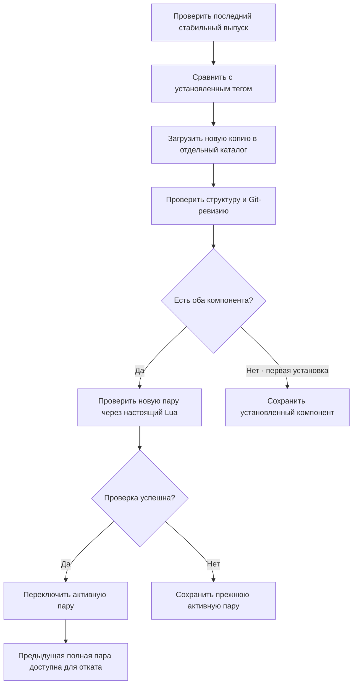

# pob2_ui

Отдельное Flutter-приложение с собственным интерфейсом для Path of Building — Path of Exile 2. Оно загружает PoB и MCP, проверяет выпуски и запускает оригинальные Lua-расчёты.

Проект начинается с нового дизайна. Интерфейс из `Hecatoncheir/PathOfBuilding-PoE2/app` не переносится. Сохраняется архитектурный принцип связи с отдельным процессом Lua; транспорт реализован через API самостоятельного [pob-poe2-mcp](https://github.com/Hecatoncheir/pob-poe2-mcp).

## Сайт и галерея

[Сайт и загрузки](https://hecatoncheir.github.io/pob2_ui/) · [Галерея работающего приложения](https://hecatoncheir.github.io/pob2_ui/gallery.html) · [Логотип и иконки](https://hecatoncheir.github.io/pob2_ui/brand.html).

В `docs/` подготовлены [одностраничный сайт](docs/index.html), [интерактивный HTML/CSS/JS-прототип](docs/prototype.html) и [логотип, палитра и SVG-иконки](docs/brand.html). Направление «Искра»: молочный фон, графитовая графика, Nunito / Nunito Sans / JetBrains Mono и спокойные анимации. Шрифты включены локально.

Откройте HTML непосредственно или выполните `python -m http.server 4173 --bind 127.0.0.1 --directory docs` и перейдите на `http://127.0.0.1:4173/`. Прототип сохраняет идеи в браузере, но не подключается к Lua и использует демонстрационные данные. Новый дизайн перенесён во Flutter; рабочие данные приходят из Lua.

В мастерской — пять рабочих разделов, большой редактор и настраиваемая панель показателей с раскрываемыми подробностями. На узких экранах показатели открываются отдельно. Добавлены поиск по дереву, два варианта, отмена/повтор, сравнение и подготовка XML для Lua. Проверки данных прототипа: `node --test tool/design_state_test.cjs`.

[Описание дизайна и правила переноса](docs/DESIGN.md). Главная ведёт в галерею настоящих окон Flutter, включая примерку и поиск на рынке из v0.1.6. Ссылки `.exe` / `.dmg` / `.run` и номер стабильного выпуска подготавливает `node tool/update_site_release.cjs` из GitHub Releases. Workflow GitHub Pages проверяет сайт и обновляет его при изменениях `main` и после успешной публикации выпуска, включая выпуск через `GITHUB_TOKEN`. Ссылки работают и без JavaScript. Старый [HTML-прототип](docs/prototype.html) сохранён как материал разработки.

## Взаимодействие компонентов


Обычный запрос: **действие пользователя → Cubit → MCP stdio → Python-адаптер → исходные классы Lua → результат → Flutter**. Flutter отображает показатели и предупреждения; игровые формулы и правила остаются в PoB. Для расчёта не требуется открывать оригинальное окно PoB или подключаться к облачному сервису.

Сеть нужна для загрузки компонентов и проверки обновлений. После установки расчёты работают локально. Сборка из пользовательского XML отправляется только локальному процессу MCP; запросам GitHub XML не передаётся.

В настройках доступны десять языков с сохранением выбора. Переводы игровых строк загружаются отдельно и кешируются для работы без сети; неизвестные описания остаются в оригинале. Поиск понимает оригинальные и переведённые названия узлов. [Источники, ограничения и проверка локализации](docs/localization.md).

Кнопки отмены и повтора (Ctrl+Z / Ctrl+Shift+Z) восстанавливают изменения текущей сборки через Lua; история до 50 действий хранится в текущем сеансе. Новое изменение очищает историю повтора. При вводе текста действует обычная отмена ввода. Сочетания для отмены, повтора, новой сборки, XML и масштаба можно изменить в настройках. На широком экране боковая панель сворачивается кнопкой и меняет ширину перетаскиванием границы; настройки сохраняются после перезапуска.

## Обновление



PoB и MCP версионируются отдельно. Проверка `doctor` подтверждает загрузку движка и чтение каталога классов; она не доказывает совместимость всех сборок и механик с будущей версией. Для проверки конкретной сборки необходим импорт её XML и анализ отчёта. Обновление и откат закрывают текущую сессию движка; последнюю успешно рассчитанную сборку можно восстановить из XML.

Копии версий не перезаписываются. Для изменения активной пары используется файловая блокировка между экземплярами приложения и замена файла настроек после проверки. Неудачные загрузки пока сохраняются в каталоге версий; автоматическая очистка ещё не реализована. Откат доступен после появления предыдущей полной пары.

## Что работает

- Молочный интерфейс «Искра»: локальные шрифты, векторная надпись PoB II, иконки, плавные переходы и системное уменьшение движения. Библиотека, мастерская и компоненты; пять рабочих разделов и панель показателей.
- Ручная проверка последних стабильных GitHub Releases двух проектов.
- Загрузка исходников по тегу в отдельные Git-копии. Для PoB загружаются `src/`, `runtime/` и корневые файлы.
- Отображение установленного тега, доступного выпуска, точной Git-ревизии и каталога.
- Проверка совместимости через `doctor`; откат к предыдущей полной паре.
- Подключение MCP в режиме `engine` через stdin/stdout, получение списка классов из Lua.
- Создание пустой сборки с выбранными классом и уровнем.
- Импорт полного XML, расчёт, показатели, условия, предупреждения и полный отчёт Lua.
- Экспорт XML в поле интерфейса; автоматическое сохранение последнего успешного состояния и его восстановление.

Подключено готовое оригинальное дерево `PassiveTreeView`: фоны, портреты, дуги, рамки и иконки. Flutter показывает сцену Lua, позволяет искать и выбирать узлы; назначение пути и возврат определяет PoB. Работают создание, изменение и удаление групп умений, полный каталог условий, библиотека XML с поиском, переименованием, заметками и копированием. Умения показаны списком слева, все добавленные камни видны; справа — каталог совместимых поддержек с оригинальными картинками. Перенос в группу добавляет поддержку, обратно в каталог — убирает. Основное умение выбирается галочкой у названия; нажатие названия открывает редактор существующей группы. Активный камень всегда первый, поддержки рядом. Удаление корзиной можно отменить через Undo/Ctrl+Z и повторить через Redo. Для обычных групп нужен [MCP v0.12.0](https://github.com/Hecatoncheir/pob-poe2-mcp/releases/tag/v0.12.0) или новее. Редактор работает с одним активным умением в группе. Эффекты мастерства, share-коды и встроенные Git/Python остаются отдельными задачами. [Контракт Lua и воспроизведение проверок](docs/LUA-CONTRACT.md).

В версии v0.1.4 добавлен редактор экипировки: знакомая схема слотов, ввод игрового текста, выбор сохранённого предмета, установка/замена/снятие, наборы I/II и Undo/Redo. Описание, требования, совместимость и влияние на показатели получает исходный Lua. Подсказки камней умений и поддержки используют оригинальный `GemTooltip` через [MCP v0.14.0](https://github.com/Hecatoncheir/pob-poe2-mcp/releases/tag/v0.14.0); установленный камень описывается с его текущим контекстом, черновик — с введёнными уровнем и качеством. Иконки слотов пока схематические.

## Установка и обновление приложения

В PoB II v0.1.16 можно [импортировать персонажа из авторизованного Path of Building](#импорт-из-открытого-path-of-building) на Windows и Linux. [PoB II v0.1.16](https://github.com/Hecatoncheir/pob2_ui/releases/tag/v0.1.16)

В PoB II v0.1.12 на Windows можно [найти Path of Building и настроить локальный мост](#импорт-из-открытого-path-of-building) прямо из раздела «Компоненты». [PoB II v0.1.12](https://github.com/Hecatoncheir/pob2_ui/releases/tag/v0.1.12)

В PoB II v0.1.11 на Windows можно [импортировать сборку из открытого Path of Building](#импорт-из-открытого-path-of-building) через локальный мост. [PoB II v0.1.11](https://github.com/Hecatoncheir/pob2_ui/releases/tag/v0.1.11)

В PoB II v0.1.10 во вкладке «Предметы» есть блок «Самоцветы» с игровыми миниатюрами. Клик по самоцвету открывает изображение и описание из Lua PoB. [PoB II v0.1.10](https://github.com/Hecatoncheir/pob2_ui/releases/tag/v0.1.10)

В PoB II v0.1.9 игровые изображения видны в описании экипировки и списке «Предмет из сборки». Установленные самоцветы отображаются прямо в гнёздах дерева пассивных умений. Изображения загружаются из PoE2DB. [PoB II v0.1.9](https://github.com/Hecatoncheir/pob2_ui/releases/tag/v0.1.9)

В v0.1.6 доступны примерка «Было → Стало» и поиск на рынке через MCP 0.15.0. Характеристики рассчитывает исходный Lua; применение проверяет ревизию примерки. Кнопка «Искать на рынке» открывает форму с лигой, базой, бюджетом и свойствами. Подготовленная ссылка открывается в браузере; скопированный предмет возвращается в редактор для примерки и применения с Undo/Redo.

Выпуск PoB II v0.1.8 добавляет подбор и редактирование поддержек для умений от экипировки. Умение и уровень задаёт предмет. Если установлен предыдущий MCP, откройте «Компоненты» и обновите PoB MCP. [PoB II v0.1.8](https://github.com/Hecatoncheir/pob2_ui/releases/tag/v0.1.8) · [MCP v0.16.0](https://github.com/Hecatoncheir/pob-poe2-mcp/releases/tag/v0.16.0)

Подготовлены установщики Windows x64 (`.exe`), Linux x64 (`.run`) и macOS Apple Silicon (`.dmg`), CI и публикация по стабильному тегу. Встроенная проверка обновлений доступна через номер версии в нижнем блоке бокового меню. Загрузка возобновляется и проверяет SHA-256; установка запускается по кнопке «Перезапустить и обновить» после сохранения сборки и XML. Предыдущая версия сохраняется для восстановления при неудачном старте. Для portable-копии предлагается страница выпусков.

[Устройство установщиков, выпуск, ограничения подписи и проверки](installer/README.md) · [Changelog](CHANGELOG.md) · [Выпуски](https://github.com/Hecatoncheir/pob2_ui/releases).

Git и 64-битный Python 3.11+ пока нужны на всех платформах. Нативные библиотеки MCP загружаются отдельно; игровые исходники не входят в этот Git-репозиторий. Linux/macOS используют настоящий Lua в режиме `engine`; изображения отчётов через GDI остаются особенностью Windows; ресурсы готового дерева и поиск влияния узлов доступны на всех трёх ОС через MCP 0.9.1.

В «Оформлении» можно выбрать светлую тему или тёмную [Gruvbox](https://github.com/morhetz/gruvbox); выбор сохраняется после перезапуска. Кнопка с графиком рядом с поиском дерева открывает поиск по характеристике и расстоянию: Lua рассчитывает влияние и тепловую карту, нажатие строки списка перемещает дерево к узлу.

Во вкладке «Дерево» переключите правую панель с «Параметров» на «План». Выберите нужные узлы и сохраните этап с уровнем персонажа. Кнопка с карандашом меняет уровень выбранного этапа. Несколько этапов могут относиться к одному уровню. При выборе этапа дерево показывает его сохранённые узлы, зелёным отмечает добавленные, а красным — снятые с предыдущего этапа. Наведение на название подсвечивает узел, а нажатие приближает его.

У этапа можно указать название, например «Акт 2», и заметку. Карандаш открывает редактирование этих полей и уровня. Название видно на шкале, заметка — при выборе этапа. «Экспорт XML» и «Скопировать XML» включают этапы вместе с названиями и заметками. Чтобы получить сборку вместе с планом, откройте этот файл или вставьте XML в PoB II.

## Запуск на Windows

Требуются Windows x64, Flutter с поддержкой Windows, Visual Studio с инструментами C++, Git и Python x64 3.11+. Для уже собранного приложения Flutter и Visual Studio не нужны; Git и Python пока нужны.

```powershell
flutter pub get --offline
flutter run -d windows --no-pub
```

`--offline` использует уже имеющийся кеш Flutter. Если нужных зависимостей SDK нет в кеше, обычный `flutter pub get` обращается к pub.dev. Прямые зависимости — Flutter SDK, Flutter Test SDK, `flutter_bloc` и официальный `file_selector` для системных файловых диалогов; сторонние MCP-серверы в систему не устанавливаются. Репозитории PoB и MCP загружаются самим приложением после нажатия «Скачать», без `pip install`.

При первом запуске откроется мастер подготовки. Нажмите «Установить компоненты»: PoB II загрузит недостающие компоненты, проверит их совместимость и подключит Lua. Для загрузки нужны Git и 64-битный Python 3.11+. Затем мастер предложит подключить папку сборок, создать сборку, открыть XML или импортировать данные из PoB. Продолжить подготовку можно в любой момент: «Настройки → Запустить подготовку».

Кнопки открытия и экспорта в заголовке сборки вызывают системные диалоги. Доступны Ctrl+O и Ctrl+S (на macOS также Cmd). Через меню «Ещё» можно вставить или скопировать XML и открыть заметки. Заметки также доступны на карточках в «Мои сборки». Последняя успешная сборка восстанавливается автоматически.

### Общая папка сборок Path of Building

«Найти папку PoB» сначала запрашивает путь через локальный мост на Windows и Linux с Wine. Если окно PoB закрыто, PoB II запускает его свёрнутым. Если получить путь не удалось, PoB II ищет существующую стандартную папку PoB. Этот поиск также доступен на macOS. Если подходящих папок несколько или ни одной нет, укажите нужную вручную. После подключения путь, смена папки и обновление списка доступны в «Моих сборках» через кнопку «Папка сборок». Окно PoB для работы с файлами не требуется.

PoB II открывает XML из этого каталога и его подпапок. Изменения сохраняются в тот же XML после расчёта. Новые сборки, копии и импортированные персонажи получают отдельные файлы. Кнопка обновления перечитывает список. Открытая сборка обновляется автоматически после сохранения XML в Path of Building. PoB II получает уведомление файловой системы и обновляет расчёт через Lua после завершения текущей операции или закрытия диалога. При возвращении фокуса в окно или обновлении списка сборок PoB II один раз сверяет открытый файл с диском.

При первом подключении каталога прежние сборки и заметки PoB II копируются в него. Исходные файлы в профиле остаются на месте. Если в общей папке уже есть одноимённая сборка, миграция сохраняет новую копию под другим именем. Заметки хранятся внутри XML и доступны в обеих программах.

Перед заменой XML PoB II сохраняет предыдущую версию в `.bak`. При переименовании и удалении прежний XML остаётся в отдельном файле `.bak`. PoB II хранит последнюю версию своих правок в профиле. Если сохранение из Path of Building заменит её, в «Моих сборках» появится отдельная сборка с суффиксом «правки PoB II», а в редакторе загрузится XML из Path of Building. Выбор версии остаётся за пользователем. После загрузки внешних изменений история Undo/Redo начинается заново.

Путь к общей папке и последняя открытая сборка записываются в `pob-builds.json` в профиле PoB II. Там же остаются настройки, черновики XML и загруженные компоненты. Для отдельного профиля задайте `POB2_UI_HOME`, для выбора интерпретатора — абсолютный путь в `POB2_UI_PYTHON`.

### Импорт из открытого Path of Building

На Windows команды поиска папки сборок, импорта из окна PoB и импорта персонажей сначала используют уже работающий мост. При необходимости PoB II подключает мост и запускает Path of Building свёрнутым. Если отдельная установка PoB отсутствует, используется загруженный компонент Path of Building. Для нескольких установок или переносной версии в другом каталоге выберите нужную папку в «Компоненты» → «Настроить мост PoB». Если PoB уже открыт без работающего моста, перезапустите его один раз. Для импорта текущей сборки разверните PoB с панели задач и откройте в нём сборку.

С MCP v0.18.1 и новее достаточно войти в аккаунт в оригинальном PoB, оставить его запущенным и в «Моих сборках» нажать «Импортировать персонажа». PoB II получит список через локальный мост и сохранит выбранного персонажа отдельной сборкой с экипировкой, умениями, деревом и самоцветами. После обновления MCP подключите мост заново и перезапустите оригинальный PoB.

На Linux команды моста могут запускать установленный Windows-выпуск PoB через Wine в сеансе X11 или XWayland. Если PoB установлен в другом префиксе, запустите PoB II с тем же `WINEPREFIX` или укажите папку установки в «Компоненты» → «Настроить мост PoB». PoB II запускает окно свёрнутым и при выходе запрашивает штатное закрытие. Для других графических сеансов можно открыть PoB через Wine вручную и использовать подключённый мост.

Оставьте сборку открытой в оригинальном PoB и нажмите «Импортировать из PoB» на экране «Мои сборки» или в мастерской PoB II. Если в мастерской уже открыта другая сборка, команда находится в меню «Ещё». Мост передаст снимок текущей сборки, а PoB II сохранит его отдельной записью в «Моих сборках».

При выходе PoB II запрашивает обычное закрытие окон PoB, которые сам запустил в этом сеансе. Если PoB покажет запрос на сохранение, ответьте в его окне. Самостоятельно открытые экземпляры PoB продолжают работать.

### Правки открытой сборки через MCP

Установите MCP v0.17.0 или новее через «Компоненты». Откройте сборку в мастерской, нажмите «Правки через MCP» и включите «Разрешить правки через MCP». Скопируйте команду подключения Codex, выполните её в терминале и закройте диалог.

Команды для дерева, предметов и умений меняют открытую сборку. PoB II показывает изменённую вкладку, пересчитывает показатели в Lua и добавляет правку в общую историю Undo/Redo. После ручной правки клиенту MCP нужно заново прочитать отчёт сборки. Доступ выключен при запуске и сбрасывается при смене сборки или отключении Lua.

## Структура исходников

```text
lib/
  domain/               модели компонентов и версий
  data/                 GitHub, Git, процессы, MCP, настройки и XML
  ui/                   представления и Cubit
test/                   проверки сохранения, ошибок обновления и интерфейса
tool/smoke.dart          проверка с настоящими Lua и MCP
windows/                стандартный Windows runner Flutter
```

## Проверки

```powershell
dart format --output=none --set-exit-if-changed lib test tool
flutter analyze --no-pub
flutter test --no-pub
flutter build windows --release --no-pub
dart run tool/smoke.dart --install
```

Последняя команда проверяет актуальные выпуски, загружает отсутствующие версии, запускает `doctor`, читает каталог, создаёт сборку, проверяет реальные показатели и повторный импорт экспортированного XML. Без `--install` использует уже загруженные компоненты. Проверка PoB не означает испытание сборки в игре.

5 ноября 2026 года проверен полный путь на загруженных с GitHub **PoB v0.23.1** (`7d6f530cbdab20389ff8bc6ba97a37ac27f74e41`) и **MCP v0.4.0** (`a0566a1199e61144f281b1703f84f4d139e83682`): 8 классов, создание Witch уровня 90, `source: original-lua`, Life 1187, экспорт и повторный импорт с тем же Life. Это техническая проверка пустой сборки, а не рекомендуемый игровой билд.

Статический анализ, проверки состояния, загрузки, контрольных сумм, безопасной распаковки и навигации проходят. CI отдельно проверяет три установщика и настоящий Lua. Полная ручная приёмка пользовательских сценариев и нового дизайна ещё не выполнена.

## Читаемость и архитектура

`WorkshopCubit` и `AppUpdateCubit` публикуют неизменяемые состояния; представления используют `BlocBuilder` / `BlocSelector`. Records связывают небольшие группы данных, например операцию и черновик XML, а patterns проверяют обязательные поля ответа Lua. Игровых формул в Dart нет.

`python tool/check_complexity.py` использует закреплённые ревизии [treesitter_cyclomatic_complexity](https://github.com/Hecatoncheir/treesitter_cyclomatic_complexity) и грамматики Dart. Проверяется `lib/` и запускатель; вложенные замыкания учитываются в родительской функции. Предел когнитивной сложности — 10. Нужны Neovim 0.11+, Git и CMake с компилятором C; грамматика собирается только в `build/`. Отчёт — `build/complexity/report.json`. Эта метрика дополняет чтение кода, анализ и тесты.

Официальный [Dart and Flutter](https://github.com/flutter/agent-plugins) версии 1.0.7 уже установлен в рабочем окружении: используются его навыки архитектуры, patterns, анализа и MCP. Сторонние исходники инструментов не входят в Git приложения.


## Продолжение разработки

Этапы, зависимости и критерии готовности ведутся в [TODO.md](TODO.md).

| Следующий выпуск | Состав | Целевая дата |
| --- | --- | --- |
| [v0.2.0](https://github.com/Hecatoncheir/pob2_ui/milestone/1) | Новый Flutter-интерфейс, отчёты Lua, библиотека и XML, компоненты, установщики трёх ОС | 19 ноября 2026 |
| [v0.3.0](https://github.com/Hecatoncheir/pob2_ui/milestone/2) | Полные редакторы умений и предметов, расширение дерева и сравнение состояний; базовое дерево и Undo/Redo уже выпущены | 10 декабря 2026 |

Даты — ориентиры по Москве; выпуск требует прохождения проверок. Для v0.3.0 обязательна ранняя проверка публичного API редакторов. Номер текущей версии при планировании не меняется.

Не расширяйте существующий Flutter-проект внутри форка PoB: вся дальнейшая работа ведётся в этом репозитории. Исходные компоненты остаются отдельными зависимостями.

## Источники

- [Официальный PathOfBuilding-PoE2](https://github.com/PathOfBuildingCommunity/PathOfBuilding-PoE2).
- [MCP-адаптер и его API](https://github.com/Hecatoncheir/pob-poe2-mcp).
- [Документация Flutter](https://docs.flutter.dev/).

Лицензии и уведомления исходных компонентов сохраняются в загруженных репозиториях. Игровые ресурсы остаются собственностью их правообладателей.

Окно запоминает размер, положение и развёрнутое состояние. На Windows это проверено настоящими перезапусками, включая отключённый экран. Дерево не содержит постоянных подписей: сведения и изменения показателей появляются при наведении, а клик назначает/возвращает узел через Lua.
