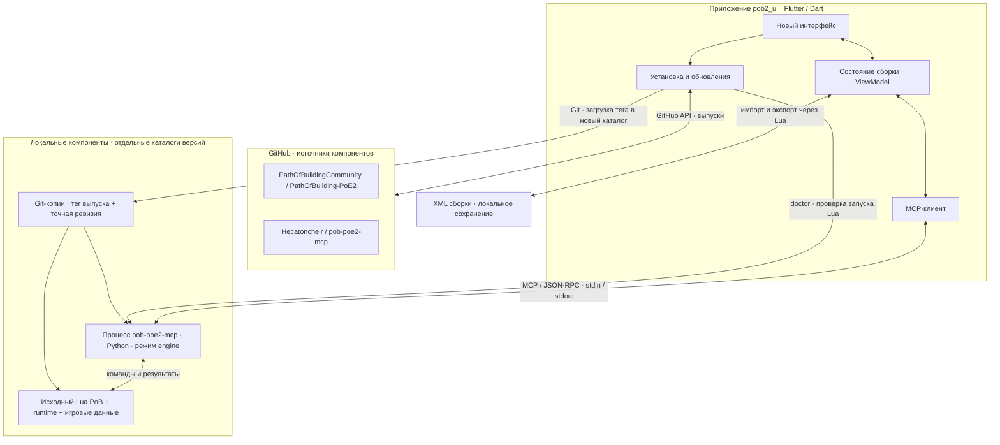
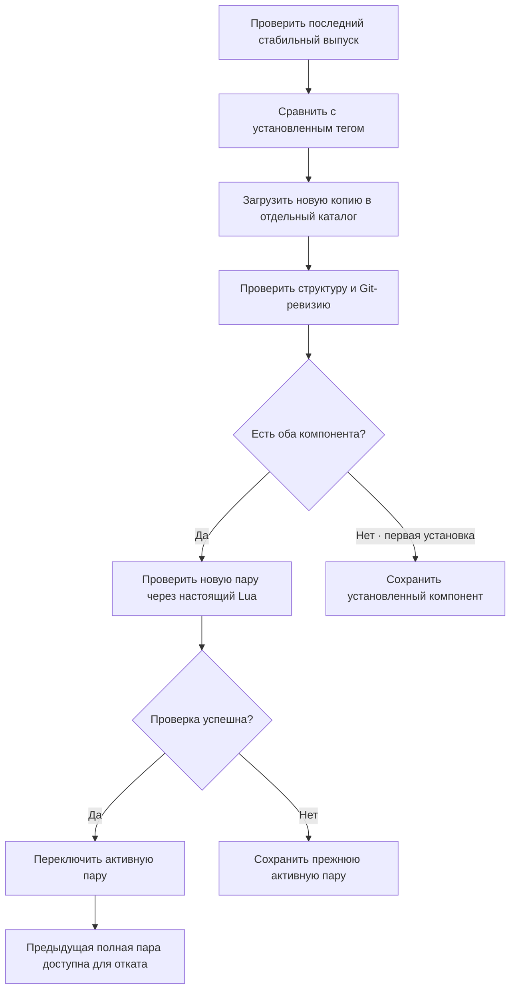

# pob2_ui

Отдельное Flutter-приложение с собственным интерфейсом для Path of Building — Path of Exile 2. Оно загружает PoB и MCP, проверяет выпуски и запускает оригинальные Lua-расчёты.

Проект начинается с нового дизайна. Интерфейс из `Hecatoncheir/PathOfBuilding-PoE2/app` не переносится. Сохраняется архитектурный принцип связи с отдельным процессом Lua; транспорт реализован через API самостоятельного [pob-poe2-mcp](https://github.com/Hecatoncheir/pob-poe2-mcp).

## Дизайн-прототип

[Сайт](https://hecatoncheir.github.io/pob2_ui/) · [Прототип приложения](https://hecatoncheir.github.io/pob2_ui/prototype.html) · [Логотип и иконки](https://hecatoncheir.github.io/pob2_ui/brand.html).

В `docs/` подготовлены [одностраничный сайт](docs/index.html), [интерактивный HTML/CSS/JS-прототип](docs/prototype.html) и [логотип, палитра и SVG-иконки](docs/brand.html). Направление «Искра»: молочный фон, графитовая графика, Nunito / Nunito Sans / JetBrains Mono и спокойные анимации. Шрифты включены локально.

Откройте HTML непосредственно или выполните `python -m http.server 4173 --bind 127.0.0.1 --directory docs` и перейдите на `http://127.0.0.1:4173/`. Прототип сохраняет идеи в браузере, но не подключается к Lua и использует демонстрационные данные. Существующее приложение Flutter пока сохраняет прежний интерфейс.

В мастерской — пять рабочих разделов, большой редактор и настраиваемая панель показателей с раскрываемыми подробностями. На узких экранах показатели открываются отдельно. Добавлены поиск по дереву, два варианта, отмена/повтор, сравнение и подготовка XML для Lua. Проверки данных прототипа: `node --test tool/design_state_test.cjs`.

[Описание дизайна и правила переноса](docs/DESIGN.md). Workflow GitHub Pages проверяет JavaScript и данные прототипа, затем публикует каталог `docs` при изменениях в `main`.

## Взаимодействие компонентов



Обычный запрос: **действие пользователя → ViewModel → MCP stdio → Python-адаптер → исходные классы Lua → результат → Flutter**. Flutter отображает показатели и предупреждения; игровые формулы и правила остаются в PoB. Для расчёта не требуется открывать оригинальное окно PoB или подключаться к облачному сервису.

Сеть нужна для загрузки компонентов и проверки обновлений. После установки расчёты работают локально. Сборка из пользовательского XML отправляется только локальному процессу MCP; запросам GitHub XML не передаётся.

## Обновление



PoB и MCP версионируются отдельно. Проверка `doctor` подтверждает загрузку движка и чтение каталога классов; она не доказывает совместимость всех сборок и механик с будущей версией. Для проверки конкретной сборки необходим импорт её XML и анализ отчёта. Обновление и откат закрывают текущую сессию движка; последнюю успешно рассчитанную сборку можно восстановить из XML.

Копии версий не перезаписываются. Для изменения активной пары используется файловая блокировка между экземплярами приложения и замена файла настроек после проверки. Неудачные загрузки пока сохраняются в каталоге версий; автоматическая очистка ещё не реализована. Откат доступен после появления предыдущей полной пары.

## Что работает

- Новый тёмный интерфейс с разделами «Компоненты» и «Сборка», компактной и широкой навигацией.
- Ручная проверка последних стабильных GitHub Releases двух проектов.
- Загрузка исходников по тегу в отдельные Git-копии. Для PoB загружаются `src/`, `runtime/` и корневые файлы.
- Отображение установленного тега, доступного выпуска, точной Git-ревизии и каталога.
- Проверка совместимости через `doctor`; откат к предыдущей полной паре.
- Подключение MCP в режиме `engine` через stdin/stdout, получение списка классов из Lua.
- Создание пустой сборки с выбранными классом и уровнем.
- Импорт полного XML, расчёт, показатели, условия, предупреждения и полный отчёт Lua.
- Экспорт XML в поле интерфейса; автоматическое сохранение последнего успешного состояния и его восстановление.

Это первая рабочая основа, а не полный перенос возможностей PoB. Редакторы дерева, предметов, умений и условий ещё не реализованы. Share-коды, импорт аккаунта, нативный выбор файлов, установщик, встроенные Git/Python и поддержка других ОС также остаются отдельными задачами. Выбор оформления пока предварительный.

## Запуск на Windows

Требуются Windows x64, Flutter с поддержкой Windows, Visual Studio с инструментами C++, Git и Python x64 3.11+. Для уже собранного приложения Flutter и Visual Studio не нужны; Git и Python пока нужны.

```powershell
flutter pub get --offline
flutter run -d windows --no-pub
```

`--offline` использует уже имеющийся кеш Flutter. Если нужных зависимостей SDK нет в кеше, обычный `flutter pub get` обращается к pub.dev. Прямые зависимости приложения — только Flutter SDK и Flutter Test SDK; сторонние MCP-серверы в систему не устанавливаются. Репозитории PoB и MCP загружаются самим приложением после нажатия «Скачать», без `pip install`.

В приложении нажмите «Проверить обновления», скачайте оба компонента, затем «Подключить Lua». Откройте «Сборка»: выберите класс и уровень или вставьте полный XML. «Получить XML» помещает экспортированный текст в поле; «Восстановить последнюю сборку» импортирует автоматически сохранённый XML.

Настройки и данные:

```text
%LOCALAPPDATA%/pob2_ui/
  components.json       активная и предыдущая пары компонентов
  session.xml           последняя успешно рассчитанная сборка
  versions/             отдельные Git-копии PoB и MCP
```

Для другого каталога задайте `POB2_UI_HOME`. Для явного выбора интерпретатора задайте `POB2_UI_PYTHON` абсолютным путём к `python.exe`. В первой версии предполагается одна активная сессия редактирования: автосохранение сборки пока не рассчитано на одновременную работу нескольких окон.

## Структура исходников

```text
lib/
  domain/               модели компонентов и версий
  data/                 GitHub, Git, процессы, MCP, настройки и XML
  ui/                   представления и ViewModel
test/                   проверки сохранения, ошибок обновления и интерфейса
tool/smoke.dart          проверка с настоящими Lua и MCP
windows/                стандартный Windows runner Flutter
```

## Проверки

```powershell
dart format --output=none --set-exit-if-changed lib test tool
flutter analyze --no-pub
flutter test --no-pub
flutter build windows --release --no-pub
dart run tool/smoke.dart --install
```

Последняя команда проверяет актуальные выпуски, загружает отсутствующие версии, запускает `doctor`, читает каталог, создаёт сборку, проверяет реальные показатели и повторный импорт экспортированного XML. Без `--install` использует уже загруженные компоненты. Проверка PoB не означает испытание сборки в игре.

5 ноября 2026 года проверен полный путь на загруженных с GitHub **PoB v0.23.1** (`7d6f530cbdab20389ff8bc6ba97a37ac27f74e41`) и **MCP v0.2.0** (`e0697726ad8b43c08e328708ef5548ec2176d1e3`): 8 классов, создание Witch уровня 90, `source: original-lua`, Life 1187, экспорт и повторный импорт с тем же Life. Это техническая проверка пустой сборки, а не рекомендуемый игровой билд.

Статический анализ проходит без замечаний. Пройдены 5 автоматических тестов: сохранение версий, сохранность рабочей пары при сбое загрузки и отката, навигация на ширинах 360 и 1280 px. Приложение собрано для Windows Release, выполнен отладочный запуск. Полный сценарий нажатий в настоящем окне и приёмка нового дизайна ещё не выполнены.

## Продолжение разработки

Этапы, зависимости и критерии готовности ведутся в [TODO.md](TODO.md).

| Следующий выпуск | Состав | Целевая дата |
| --- | --- | --- |
| [v0.2.0](https://github.com/Hecatoncheir/pob2_ui/milestone/1) | Новый Flutter-интерфейс, отчёты Lua, библиотека и XML, компоненты, первый Windows ZIP | 19 ноября 2026 |
| [v0.3.0](https://github.com/Hecatoncheir/pob2_ui/milestone/2) | Дерево, умения, предметы и условия через Lua, история и сравнение, проверенный Windows ZIP | 10 декабря 2026 |

Даты — ориентиры по Москве; выпуск требует прохождения проверок. Для v0.3.0 обязательна ранняя проверка публичного API редакторов. Номер текущей версии при планировании не меняется.

Не расширяйте существующий Flutter-проект внутри форка PoB: вся дальнейшая работа ведётся в этом репозитории. Исходные компоненты остаются отдельными зависимостями.

## Источники

- [Официальный PathOfBuilding-PoE2](https://github.com/PathOfBuildingCommunity/PathOfBuilding-PoE2).
- [MCP-адаптер и его API](https://github.com/Hecatoncheir/pob-poe2-mcp).
- [Документация Flutter](https://docs.flutter.dev/).

Лицензии и уведомления исходных компонентов сохраняются в загруженных репозиториях. Игровые ресурсы остаются собственностью их правообладателей.
