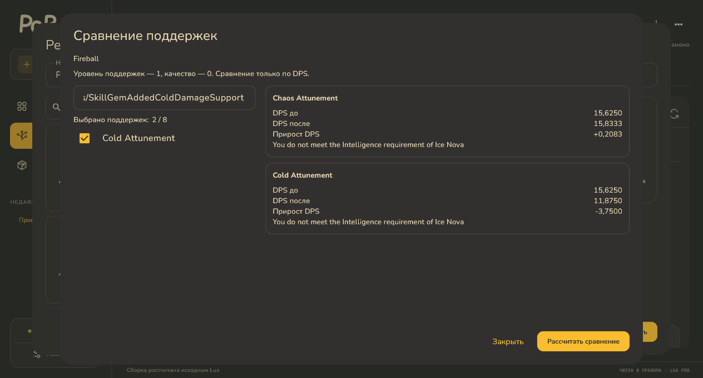

# Приёмка PoB II v0.13.0

Выпуск **[PoB II v0.13.0](https://github.com/Hecatoncheir/pob2_ui/releases/tag/v0.13.0)** (`0.13.0+50`) опубликован 21 ноября 2026 года. Неизменяемый тег указывает на `d3417341aeec2aa1ed3b774b5710dba4d652370e`. Предварительный и обязательный релизный CI прошли на трёх ОС; публичные установщики скачаны и проверены по размеру и SHA-256. Даты публикации приведены по Москве.

## Компоненты

Закреплены официальный PoB v0.23.1 (`7d6f530cbdab20389ff8bc6ba97a37ac27f74e41`) и [опубликованный MCP v0.24.1](https://github.com/Hecatoncheir/pob-poe2-mcp/releases/tag/v0.24.1) (`312b337fa4a24f5ef55ebd38c8fd7bd46c7de78a`). Официальный тег PoB проверен через `ls-remote`; архив PoB повторно использован без изменения байтов.

[CI MCP](https://github.com/Hecatoncheir/pob-poe2-mcp/actions/runs/44755637761) прошёл на Windows, Linux и macOS, включая транспорт и мост Wine. Скачаны wheel, Windows portable, две нативные библиотеки и SHA256SUMS; SHA-256 каждого файла совпал с GitHub и манифестом.

Четыре архива [комплекта `components-0.23.1-0.24.1`](https://github.com/Hecatoncheir/pob2_ui/releases/tag/components-0.23.1-0.24.1) опубликованы с SHA256SUMS. Рецепт закреплён тегом в `2251f04`. Размеры и SHA-256 зафиксированы в `lib/data/component_packages.dart`; архив PoB сохранён побайтно из прежнего проверенного комплекта.

Установка новой пары из локального проверенного кеша прошла штатным установщиком в отдельный профиль. Smoke подтвердил `source=original-lua`, `xmlRoundTrip=true`, 4544 узла и 629 текстур. После публикации повторно скачаны все четыре архива и SHA256SUMS с публичного адреса: размеры и SHA-256 совпали с локальными файлами, манифестом и метаданными GitHub.

## Подтверждённый состав

- Состав группы, число включённых поддержек, область общих поддержек и предупреждения исходного Lua.
- Подбор совместимости выбранного камня в полной группе, включая несколько активных камней и умения от экипировки.
- Сравнение от одной до восьми поддержек уровня 1 с качеством 0 из одного XML. DPS до, после, разница, ошибки и предупреждения каждого кандидата; ранжирование по разнице DPS.
- Отсутствующий DPS не заменяется нулём. Смена группы, цели или сборки отклоняет результат. Просмотр не меняет XML, выбранное умение и Undo/Redo.
- Отдельные вкладки выбора и результатов на узком экране; переводы интерфейса.

Вместимость конкретного умения **не подтверждена**: PoB v0.23.1 не предоставляет этого значения. `capacity=null`, `capacityStatus=unavailable`; UI показывает «Вместимость ячеек неизвестна». Общий порог предупреждения о числе поддержек не используется как ограничение редактирования. Зависимость остаётся открытой в TODO.

## Проверки

- Контракт исследован в исходном Lua PoB и в отдельной сессии расчёта. Обычная группа, несколько активных камней, умение от предмета, порог предупреждения и сохранность рабочего XML покрыты тестами MCP.
- Локальный набор MCP: 107 тестов, один пропуск; дополнительный сценарий маршрутизации MCP и проверки схемы прошёл отдельно. Исправлена проверка области поддержек предмета: принимается исходное `skill` или `slot`, а не предположение о единственном варианте.
- Проверки Flutter: полная группа и цель, ранжирование, независимые ошибки, отрицательный/отсутствующий DPS, подмена ID, бесконечные числа, изменение группы и сборки, окна 1280 и 390 пикселей. 15 проверок сравнения и существующей мастерской прошли.
- Статический анализ: без замечаний. Когнитивная сложность: превышений предела 10 нет.
- Полный набор Flutter: 301 тест прошёл, один пропущен. Дополнительные проверки покрывают сравнение после собственного сохранения и перенос поддержки при размере панели 720×450.
- Восемь кандидатов на закреплённой Windows-паре: ошибок нет, исходные XML и ревизия сохранились; один локальный замер занял 4,688 секунды.
- Нативная приёмка Windows на закреплённой паре: все три сценария `integration_test/editors_test.dart` прошли одним запуском за 5 минут 1 секунду. Новое окно сравнения проверено через обычный редактор группы; отдельный контроль Lua совпал с порядком UI, исходные XML и Undo/Redo сохранились. Предыдущие неудачные попытки помогли исправить низкую панель каталога и обращение теста к кнопке фонового окна.
- Обновление компонентов с пары v0.12.1 в отдельном профиле прошло: пять файлов библиотеки, XML с двухстрочной заметкой и настроек сохранили SHA-256, Unicode-путь сохранился. Активен MCP v0.24.1, для отката оставлен MCP v0.23.0.
- После изменений выполнена горячая перезагрузка работающего Windows-приложения: успешна. Подключение DTD и `get_runtime_errors` не выявило ошибок выполнения. Тестовый экземпляр завершён штатно.
- `flutter build windows --release --no-pub` собрал локальный Windows Release за 71,1 секунды. Выпускаемые установщики собраны и проверены релизным CI на точной ревизии тега.
- Первый прогон CI приложения остановился на устаревшем ожидании 42 инструментов MCP: опубликованная версия предоставляет 43, включая `pob_compare_supports`. Анализ, тесты, сборка установщиков и запуск Lua до этого шага прошли на трёх ОС. Проверка каталога исправлена; локальный Windows Release сохранил XML и завершился через MCP с кодом 0. После исправления полный CI кандидата прошёл на трёх ОС.
- Повторный прогон выявил фоновую синхронизацию библиотеки на macOS между сохранением и закрытием. Сценарий ждёт завершения операции до 120 секунд, повторяя только явно отклонённую до выполнения команду с `APP_BUSY`; остальные ошибки завершают проверку. Защита занятого приложения сохраняется.
- Следующий прогон macOS прошёл установку, обновление, сравнение путей, мастерскую и пакетное сравнение поддержек. Сценарий одиночного предпросмотра нашёл кнопку фонового каталога под открытым редактором. Поиск ограничен текущим диалогом, добавлены прокрутка и ожидание готовности; снимки при тайм-ауте теперь доступны и для сценариев XML.
- После исправления поиска кнопки все три нативных сценария редакторов повторно прошли на Windows одним запуском за 5 минут 19 секунд; статический анализ и предел сложности 10 также соблюдены.
- [Полный CI кандидата](https://github.com/Hecatoncheir/pob2_ui/actions/runs/44787901803) и [релизный CI](https://github.com/Hecatoncheir/pob2_ui/actions/runs/44810433432) прошли на Windows x64, Linux x64 и macOS arm64. Подтверждены установка, обновление с последнего стабильного v0.12.1, сохранность XML/заметок/настроек, восстановление без сети, откат, редакторы, управление через MCP и десять языков. В предварительном прогоне GitHub сначала не выделил macOS runner; повтор только macOS завершился успешно с сохранением результатов Windows/Linux.

## Результаты выпуска

- Комплект компонентов опубликован и повторно скачан: четыре ZIP и SHA256SUMS совпали с закреплёнными размерами, манифестом и GitHub.
- Код и переводы закреплены неизменяемым тегом v0.13.0 на `d3417341aeec2aa1ed3b774b5710dba4d652370e`. [Обязательный релизный CI](https://github.com/Hecatoncheir/pob2_ui/actions/runs/44810433432) завершился успешно.
- Публичные установщики и SHA256SUMS скачаны после публикации. Реальные размеры и хеши совпали с метаданными GitHub и манифестом:

| Файл | Байт | SHA-256 |
| --- | ---: | --- |
| [pob2-ui-0.13.0-linux-x64.run](https://github.com/Hecatoncheir/pob2_ui/releases/download/v0.13.0/pob2-ui-0.13.0-linux-x64.run) | 29136306 | `cf18b5436324eb2d466d20acfd281640cfd60e19b5cb75d7a2ae1fb1e35852f1` |
| [pob2-ui-0.13.0-macos-arm64.dmg](https://github.com/Hecatoncheir/pob2_ui/releases/download/v0.13.0/pob2-ui-0.13.0-macos-arm64.dmg) | 40269366 | `c329eed3d7b110b8cd75e6408acc81d5665dd088f1b629afa7dac9882dfa408f` |
| [pob2-ui-0.13.0-windows-x64-setup.exe](https://github.com/Hecatoncheir/pob2_ui/releases/download/v0.13.0/pob2-ui-0.13.0-windows-x64-setup.exe) | 25495526 | `409aa9c052a6cf2397f20b33e9573a5de749371120768a089f47dd4c245bbf69` |
| [SHA256SUMS](https://github.com/Hecatoncheir/pob2_ui/releases/download/v0.13.0/SHA256SUMS) | 295 | `adfa121efab3946e2f160c0e5f685b723af81ad273b9b0d332465465a6aa8e6a` |

- [Живой сайт](https://hecatoncheir.github.io/pob2_ui/) проверен по содержимому: каталог показывает v0.13.0, ссылки ведут на проверенные файлы. Снимок сравнения поддержек доступен с правильными байтами.
- README и TODO актуализированы; 13-02/13-03 закрыты, неизвестная вместимость 13-04 остаётся открытой задачей P2 без назначенного выпуска.
- Windows публикуется без Authenticode; macOS использует подпись ad hoc с проверкой codesign в CI, без Developer ID и нотариализации. Сертификаты издателя и физическая проверка Gatekeeper относятся к следующему этапу.

Проверки используют отдельные профили и демонстрационные сборки. Пользовательские XML и установленный PoB не изменяются. Физические проверки macOS, Gatekeeper и Linux с Wayland недоступны; результаты CI не заменяют их. Расчёт PoB не является испытанием сборки в игре.
